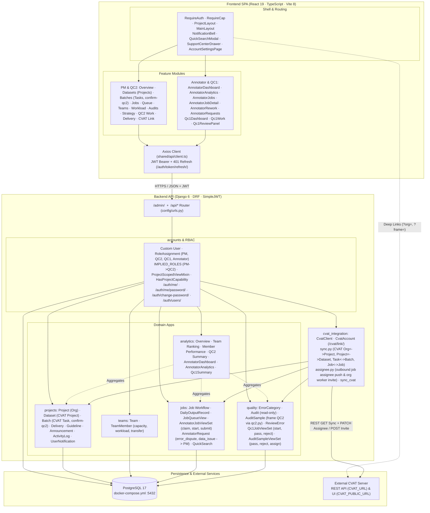

# VanoHub System Architecture

Combined system architecture across the VanoHub backend (Django / DRF) and frontend SPA (React / TypeScript / Vite).

**CVAT ↔ VanoHub Hierarchy & Boundaries:**
- `CVAT Organization ↔ Project` (`cvat_org_id`, `cvat_org_slug`, UI `"Organization"`)
- `CVAT Project ↔ Dataset` (`cvat_project_id`, UI `"Project"`)
- `CVAT Task ↔ Batch` (`cvat_task_id`, `qc2_confirmed_at`, UI `"Task"`)
- `CVAT Job ↔ Job` (`cvat_job_id`, `cvat_start_frame`, `cvat_assignee_id`, UI `"Job"`)
- **Outbound CVAT writes** (`backend/cvat_integration/assignee.py`) are strictly limited to CVAT job `assignee` updates and organization `worker` invitations. **QC2** runs frame-level deterministic sampling across every job entering `pending_qc2` (`backend/quality/qc2.py`).

## Key File References

- **Infrastructure & Entry**: `docker-compose.yml`, `backend/config/urls.py`, `backend/config/settings.py`, `frontend/src/App.tsx`, `frontend/src/app/router.tsx`, `frontend/src/shared/api/client.ts`
- **Backend Apps**: `backend/accounts/permissions.py`, `backend/accounts/models.py`, `backend/projects/models.py`, `backend/teams/models.py`, `backend/jobs/models.py`, `backend/quality/models.py`, `backend/quality/qc2.py`, `backend/analytics/urls.py`, `backend/cvat_integration/models.py`, `backend/cvat_integration/urls.py`, `backend/cvat_integration/sync.py`, `backend/cvat_integration/assignee.py`
