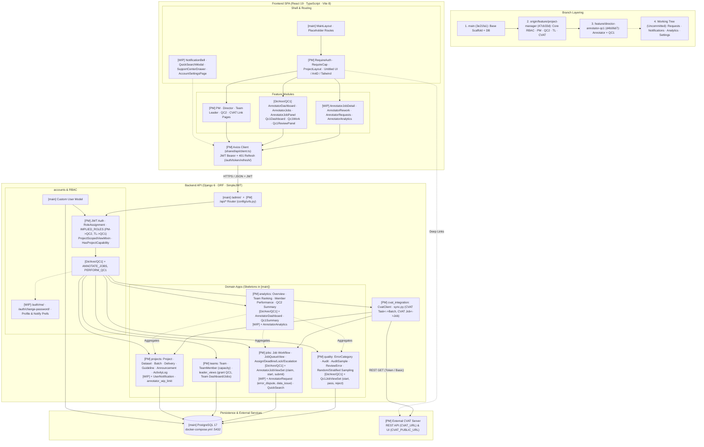

# VanoHub System Architecture

Combined system architecture across all repository branches (`main`, `origin/feature/project-manager`, `feature/director-annotator-qc1`) and uncommitted working-tree additions.

## Key File References

- **Infrastructure & Entry**: `docker-compose.yml`, `backend/config/urls.py`, `backend/config/settings.py`, `frontend/src/App.tsx`, `frontend/src/app/router.tsx`, `frontend/src/shared/api/client.ts`
- **Backend Apps**: `backend/accounts/permissions.py`, `backend/accounts/models.py`, `backend/projects/models.py`, `backend/teams/models.py`, `backend/jobs/models.py`, `backend/quality/models.py`, `backend/analytics/urls.py`, `backend/cvat_integration/sync.py`
